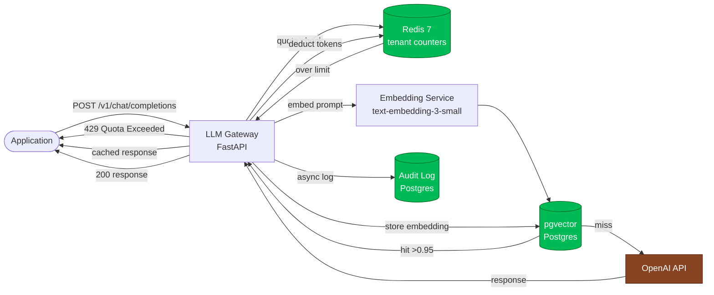

# LLM Quota Gateway

> Part of the [jotive.dev](https://dev.jotive.com.co) technical portfolio — Backend Engineer · Python · Node.js

Production-grade LLM proxy with per-tenant quota enforcement, semantic response caching, prompt audit logging, and provider failover. Sits between your application and the LLM provider — gives you cost control, observability, and resilience without modifying application code.

---

## The Problem

**Diego** is CTO at a Colombian startup building an AI-powered legal document assistant. 200 paying customers. OpenAI bill: unpredictable. Last month a single misconfigured job looped and generated $800 in LLM calls in 4 hours before anyone noticed.

Two specific problems:

1. **No per-tenant quota.** All customers share the same OpenAI key. One customer on a free trial can burn the same tokens as an enterprise customer. Diego has no way to cap usage per plan.

2. **No caching.** Customers frequently ask the same questions about the same documents. "What is the penalty clause in this contract?" asked 40 times a day by different users generates 40 API calls to OpenAI. The answer doesn't change. Each call costs money and adds 1.5s latency.

The fix is a gateway layer: enforce quota before the call, check semantic cache before the call, log every call after. If the semantic similarity of a new prompt to a cached response is >0.95, return the cached response — no API call, <50ms latency, zero cost.

**This project demonstrates that gateway running in production-like conditions.**

---

## What this solves

- Per-tenant daily/monthly token quota with hard cap — free tier cannot exceed limit
- Semantic cache: embedding similarity >0.95 = cached response, 30-40% cost reduction
- Full prompt + response audit log for compliance and debugging
- Provider failover: OpenAI down → route to Anthropic with same interface
- Admin API for quota inspection and manual override

---

## What this demonstrates

- **Proxy architecture:** Transparent LLM proxy, drop-in replacement for OpenAI client
- **Semantic caching:** Embeddings stored in pgvector, cosine similarity lookup before every call
- **Rate limiting:** Per-tenant token bucket with token consumption tracking (not request count)
- **Async processing:** Non-blocking audit logging — never adds latency to the critical path
- **Observability:** Cost per tenant per day, cache hit rate, p95 LLM latency, provider error rate
- **Failover:** Circuit breaker per provider, automatic rerouting

---

## Stack

**Backend:** Python 3.12 · FastAPI · Pydantic v2
**Caching:** PostgreSQL 16 + pgvector · Redis 7
**LLM:** OpenAI SDK · Anthropic SDK
**Embeddings:** text-embedding-3-small (OpenAI)
**Observability:** Prometheus · structured JSON logs
**Runtime:** Docker · docker-compose
**CI/CD:** GitHub Actions · ruff · pytest · coverage

---

## Architecture



**Request flow:**

1. Application sends standard OpenAI-format request to gateway.
2. Gateway checks per-tenant quota in Redis — if exceeded, returns `429` with `Retry-After`.
3. Gateway embeds the prompt, queries pgvector for cosine similarity >0.95.
4. Cache hit → returns cached response immediately. No LLM call.
5. Cache miss → forwards to LLM provider, stores response + embedding.
6. Deducts token count from Redis quota counter.
7. Fires async task to append to audit log (never blocks response).

See [`/docs/adr/`](./docs/adr/) for trade-off analysis.

---

## Architecture Decision Records

| ADR | Decision | Status |
|---|---|---|
| [001](./docs/adr/ADR-001-proxy-not-sdk-wrapper.md) | Proxy over SDK wrapper — drop-in compatibility | Accepted |
| [002](./docs/adr/ADR-002-semantic-cache-pgvector.md) | pgvector over Pinecone for semantic cache | Accepted |
| [003](./docs/adr/ADR-003-token-quota-not-request.md) | Token-based quota over request-count quota | Accepted |
| [004](./docs/adr/ADR-004-async-audit-log.md) | Async audit log — never on critical path | Accepted |
| 005 | Provider failover strategy | Pending |

---

## Local development

```bash
# Requirements: Docker Desktop, Python 3.12+, OpenAI API key

cp .env.example .env      # add OPENAI_API_KEY
make up                   # builds + starts gateway + Postgres (pgvector) + Redis
make migrate              # alembic upgrade head (creates audit + embedding tables)
make logs                 # tail gateway logs
make down                 # stop stack
```

Gateway at `http://localhost:8000/v1` — compatible with OpenAI client. Admin at `/api/v1/admin`. Metrics at `/metrics`.

See [`PROGRESS.md`](./PROGRESS.md) for the current build log.

---

## Author

**[Jotive.dev](https://dev.jotive.com.co)** — Backend Engineer · Python · Node.js
[GitHub](https://github.com/jotive) · [LinkedIn](https://www.linkedin.com/in/jotive/)

---

## License

MIT
